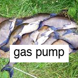
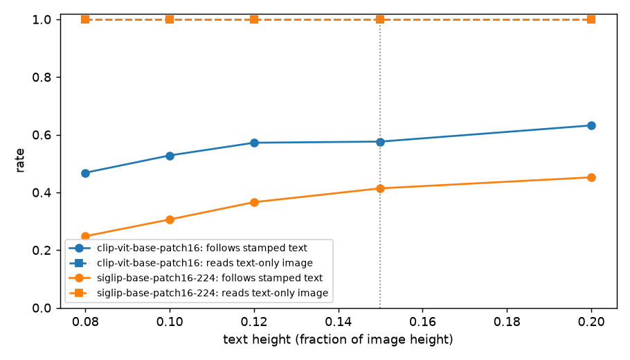
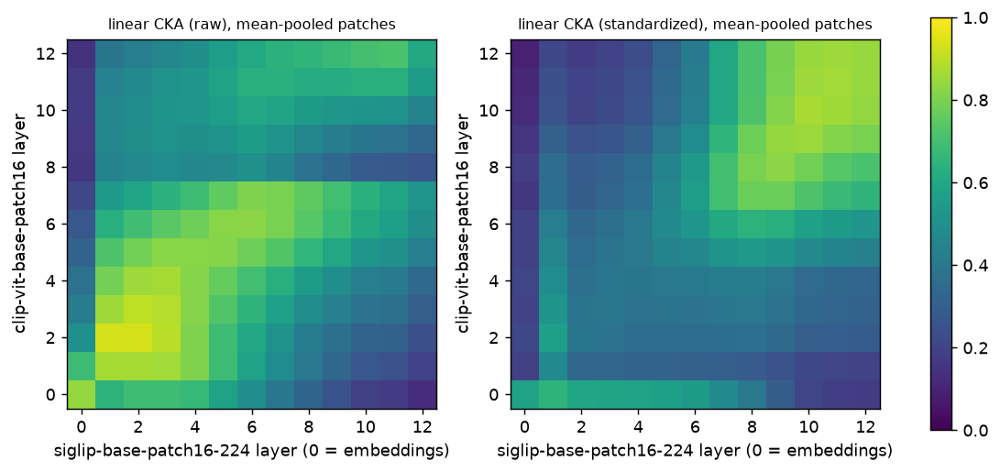
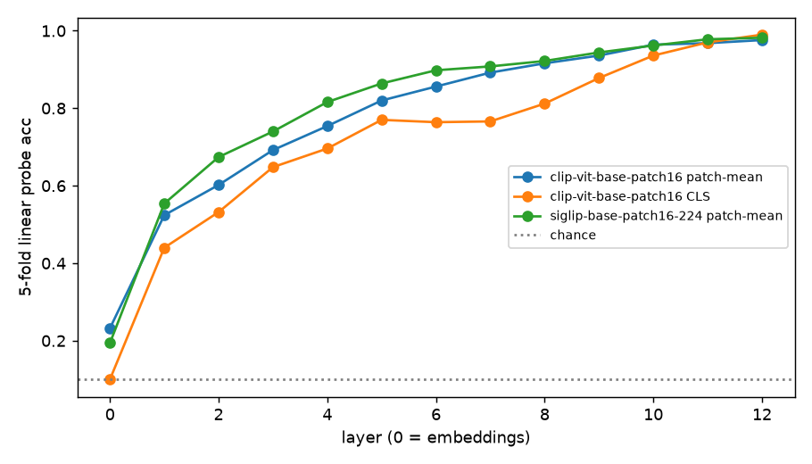

# Reading isn't trusting: diffing CLIP and SigLIP from the inside

Write "gas pump" on a photo of a fish and ask CLIP what it sees. On the photo below, it says gas
pump, with a score of 0.99. This is the well-known *typographic attack*
([Goh et al., 2021](https://distill.pub/2021/multimodal-neurons/)). Across 500 photos, each stamped
with the name of a wrong class, CLIP went with the text 58% of the time. SigLIP did so 41% of the
time. Yet SigLIP reads the text just as well: at every text size I tried, both models classify an
image containing *only* a written class name perfectly. The two models differ in how much they
*trust* what they read, not in whether they can read it.



*Both models call the clean photo a tench and the stamped one a gas pump. SigLIP isn't immune; it
just falls for the text less often across the full set.*

That's one of several things that fell out of a simple experiment: take two vision encoders with the
same architecture but different training, and compare them from the inside. It's worth looking at the
results in two different ways, because CLIP and SigLIP lead two different lives:

- **As models in their own right.** People use them directly for zero-shot classification, retrieval,
  and filtering. What matters there is the final embedding each model produces.
- **As the backbones of vision-language models.** LLaVA-1.5 sees the world through a CLIP encoder.
  LLaVA-OneVision, PaliGemma, Idefics2 and many newer VLMs see it through SigLIP. What matters there
  is something else entirely: the patch tokens the VLM takes from the middle of the encoder.

Section A covers the first view, section B the second. Results from the first don't automatically
carry over to the second.

## Why I'm doing this

I'm working toward mechanistic interpretability of vision-language models used for driving, many
of which are fine-tuned from Qwen-VL. A driving model that misreads a sign, or trusts a sticker on
one, is a safety problem, not a benchmark footnote.

Rather than start with a 7B driving model, I'm building up in stages. Each stage adds one piece of
machinery:

1. **CLIP**: the vision encoder on its own.
2. **LLaVA**: the same kind of encoder (LLaVA-1.5 literally uses a frozen CLIP), plus a small
   projector into a language model.
3. **Qwen-VL**: an encoder trained jointly with the LM, native-resolution inputs, token merging.
4. **The driving fine-tune.**

This post is from stage 1. The question: if you hold the vision architecture fixed and change only
the training recipe, what changes inside the model?

## The setup

CLIP ([Radford et al., 2021](https://arxiv.org/abs/2103.00020)) and SigLIP
([Zhai et al., 2023](https://arxiv.org/abs/2303.15343)) are both image–text dual encoders. I
compared the two base models with the same patch size:

|                   | CLIP ViT-B/16                       | SigLIP B/16 (224px)                         |
|-------------------|-------------------------------------|---------------------------------------------|
| Vision backbone   | ViT, 12 layers, width 768, patch 16 | ViT, 12 layers, width 768, patch 16         |
| Training loss     | softmax contrastive over the batch  | independent sigmoid per image–text pair     |
| Image readout     | CLS token → LayerNorm → projection  | no CLS; attention-pooling head over patches |
| Training data     | WIT-400M                            | WebLI                                       |

The architecture is matched. The loss, the readout and the data are not. The data difference is a
confounder I can't remove, so read everything below as "what this recipe does," not "what the loss
does."

These are the *base-size* models, chosen so the architecture matches exactly. VLMs typically use larger
variants (CLIP ViT-L/14 at 336px, SigLIP So400m/14 at 384px), so treat this as a controlled first look,
not a measurement of any specific VLM's encoder.

Data: 500 images from the Imagenette validation set (50 each from 10 easy ImageNet classes),
center-cropped to square (more on why in A3). Everything runs on a 16 GB laptop in about five minutes.

---

# A. CLIP and SigLIP as models in their own right

Here the product is the final image embedding and its similarity to text. All three results in this
section are measured there.

## A1. Same answers, very different confidence

On plain images the two models are nearly interchangeable: 98.8% zero-shot accuracy for CLIP,
99.2% for SigLIP, and the same prediction on 98.6% of images.

Their confidence looks nothing alike. CLIP's top softmax probability averages 0.99. SigLIP's top
sigmoid score averages **0.42**, and it's below 0.5 on **58%** of images, even though SigLIP gets
99.2% of them right.

This isn't SigLIP being unsure. A sigmoid scores each image–text pair independently; the numbers
don't sum to one across labels, and there's a learned bias baked in. "0.44" means something
different from CLIP's "0.42." (CLIP's number isn't absolute either: a softmax over 10 labels is
far more peaked than one over 1,000.) The practical lesson: **if you port a confidence threshold from CLIP
to SigLIP, it will misfire**. That's worth knowing before either one ends up inside a filter or a
system that defers to a human when unsure.

## A2. SigLIP keeps images and text further apart

CLIP's image and text embeddings famously sit in separate regions of the shared space: the
*modality gap* ([Liang et al., 2022](https://arxiv.org/abs/2203.02053)). SigLIP's gap is larger:

- Distance between the image and text centroids: **1.15** (SigLIP) vs **0.91** (CLIP)
- Average cosine similarity between an image and its own class's text: **0.10** vs **0.30**

Yet SigLIP classifies slightly better. A pairwise sigmoid loss only needs the right text to *rank*
first for each image; it never asks image and text to actually be close. Closeness and usefulness
are different things, so raw cosine values also don't transfer between the two models.

## A3. Reading isn't trusting

Back to the opening experiment. I stamped the name of a *wrong* class onto every image, and
separately rendered each class name as plain text on a gray background.

|                                             | CLIP               | SigLIP             |
|---------------------------------------------|--------------------|--------------------|
| Accuracy on text-only images (just reading) | 100%               | 100%               |
| Accuracy on images with a wrong label       | 42%                | 58%                |
| How often it predicts the stamped class     | **58%** [53, 62]   | **41%** [37, 46]   |

(Text height 15% of the image; brackets are 95% bootstrap intervals over images. The paired
difference is 16 points, 95% CI [12, 21].)

One number isn't enough to separate reading from trusting: maybe SigLIP just reads text less
reliably at this size. So I swept the text size and ran the text-only test at every size too.



Both models read every text-only image correctly at every size. Both follow the text more as it gets
bigger, and CLIP follows it 16–22 points more often than SigLIP at every size. The difference is how text is *weighted*
against visual evidence, not whether text gets read.

A trap I fell into on the way. Most Imagenette photos are 4:3, and the two models' preprocessors
handle that differently: CLIP's crops the center square, and SigLIP's squashes the whole image to a
square. In my first run, CLIP saw labels with their ends cut off and SigLIP saw them squeezed to 75%
width. On those inputs SigLIP followed the text only 31% of the time, and the gap looked twice as big.
Center-cropping everything to square before stamping gives both models the same input, and the
numbers above. Text-attack results are sensitive to small changes in how the text is rendered, so
compare models on identical pixels.

**If you use these models directly**, SigLIP is the more robust choice against this kind of attack,
but 41% is far from immune. That's the clean result of section A. The harder question is whether it
survives when SigLIP becomes part of a bigger model.

---

# B. CLIP and SigLIP as VLM backbones

## B1. What a VLM actually takes from the encoder

A VLM doesn't use the vision encoder the way zero-shot classification does. From the model configs on
Hugging Face:

| VLM                                | Vision tower                 | What the language model receives                   |
|------------------------------------|------------------------------|----------------------------------------------------|
| LLaVA-1.5-7B                       | CLIP ViT-L/14, 336px         | patch tokens from the second-to-last layer, no CLS |
| LLaVA-OneVision, LLaVA-Interleave  | SigLIP So400m/14, 384px      | patch tokens from the last kept layer              |

Neither family uses the encoder's final readout. LLaVA drops CLIP's CLS token. SigLIP-based VLMs drop
SigLIP's attention-pooling head. The language model gets the patch tokens directly, through a projector.

Many VLMs also keep training the encoder. PaliGemma uses SigLIP So400m but unfreezes it during
multimodal training, and Idefics2 retrains SigLIP to accept images at their native resolution and aspect
ratio. The "SigLIP" inside those models is no longer the SigLIP that was benchmarked on its own.

**None of section A is automatically inherited.** Confidence, modality gap and typographic robustness
were all measured on the pooled embedding, which VLMs throw away. So for this part, I looked at the
patch tokens layer by layer instead.

## B2. The CKA trap, and an outlier dimension

To compare the two encoders layer by layer, I used linear CKA
([Kornblith et al., 2019](https://arxiv.org/abs/1905.00414)). It measures whether two sets of
features arrange the same images similarly, regardless of basis. Each image is represented by
the mean of its patch tokens at every layer. That's pooled from the same tokens a VLM receives, and
it makes the two models comparable even though only CLIP has a CLS token.

My first result said: the two models agree through layer 7, then abruptly diverge at layer 8
(CKA 0.80 → 0.38).

That turned out to be an artifact. At layer 8, **a single dimension in CLIP suddenly carries 48% of
the variance** across images (up from under 9% in layers 1–7). SigLIP has nothing like it:
its largest dimension never takes more than 7% after the embedding layer. Linear CKA is
dominated by high-variance directions, so that one dimension swamped the whole comparison.

Standardizing each dimension first reverses the story. The models are *least* alike in the early
and middle layers (CKA ~0.39 in layers 2–4) and **converge toward the end** (0.87 at layer 10).
Two different recipes, starting from different low-level features, land on similar high-level
representations. That's exactly the region VLMs read from.



Two takeaways:

- **Methodological:** check for outlier dimensions before trusting CKA, and report both views. The
  same caution applies to anything variance-weighted: probes without standardization, PCA, and
  sparse autoencoders. That last one matters, because SAEs on VLM activations are a natural next tool.
- **Open question:** what is that dimension, and what does a VLM's projector make of it? Vision
  transformers are known to develop high-norm "massive activations" and register-like tokens
  ([Darcet et al., 2023](https://arxiv.org/abs/2309.16588);
  [Sun et al., 2024](https://arxiv.org/abs/2402.17762)). This is plausibly the same phenomenon,
  but I haven't verified it yet.

## B3. CLIP's patches know the class before its CLS token does

I trained a linear probe at every layer to predict the class. For CLIP I probed both the CLS token
and the mean of the patch tokens.



CLIP's CLS token stalls around 77% accuracy through layers 5–7, while its patch tokens keep
climbing (82% → 89%). CLS only catches up in the last three layers, as the model's final readout
pulls the answer into it. SigLIP's patch tokens follow a similar curve, running 4–7 points ahead of
CLIP's in layers 2–6 before the two converge.

This is good news for LLaVA's design choice. In this model, the patch tokens at the second-to-last
layer are already as decodable as CLS (97% each), so dropping CLS costs little. (LLaVA uses the larger
ViT-L, so that's worth rechecking there.) It's also a warning for
interpretability: analyses of CLIP's final embedding, including the exact per-head decomposition of
[Gandelsman et al. (2024)](https://arxiv.org/abs/2310.05916), describe a readout LLaVA never uses. For VLMs, the patch tokens are where the story is.

## B4. The open question: does SigLIP's advantage survive?

To be clear about what is and isn't in doubt: **text attacks themselves certainly carry into VLMs.**
VLMs read text in images very well (OCR is a core skill they're trained for), so the written text
clearly survives in the patch tokens. And a VLM's language model is trained to *follow* text, so
writing in an image can act as an instruction ("ignore the pedestrian"), not just a label. That's
visual prompt injection, a failure CLIP can't have at all. If anything, VLMs give text attacks more
ways to work.

What's in doubt is **SigLIP's advantage**: section A's result that it follows stamped text 16 points
less often than CLIP. That depends on **where SigLIP down-weights text**:

- If it happens **in the patch tokens**, SigLIP-based VLMs inherit the advantage.
- If it happens **in the attention-pooling head**, that part of SigLIP is thrown away before any VLM
  sees it. Choosing a SigLIP backbone would then buy no protection over CLIP.

For driving, this is the central question. Signs are text. Stickers on signs, billboards showing
cars or people, and projected "phantom" signs are all ways of putting persuasive text or imagery
into a scene. A model that can't read a speed-limit sign is useless, and a model that believes
every sticker is dangerous. What matters is how much weight text gets against everything else in the scene. Given how many VLMs sit on SigLIP, finding where this trust is decided is
the experiment I'm most keen to run next.

---

## Caveats

- **10 easy classes, 500 images, one random seed.** Clean accuracy is near ceiling, and so is
  text-only reading (a 10-way choice from a clean rendered word is easy). The bootstrap intervals
  cover resampling images, not the choice of classes, seed or stamp style.
- **Base-size encoders.** VLMs use larger variants; the backbone-level findings need repeating on
  CLIP ViT-L/14 at 336px and SigLIP So400m/14 at 384px.
- **One stamp style.** Size is swept, but it's always a white box with black Helvetica at a fixed
  position. As the preprocessing trap in A3 shows, attack rates move with how the text looks.
- **Data is a confounder.** WIT-400M vs WebLI could explain any of these differences on its own.
  A cleaner test would compare models trained on the same data with only the loss changed.
- **Probes and CKA are correlational.** They say what's decodable or similar, not what the model
  uses. The causal follow-ups are next.

## What's next

1. **Where does SigLIP down-weight text: in the patch tokens or in the pooling head?** Decompose
   the attention-pooling head's output, and measure how much the stamped text dominates the patch
   tokens themselves. This decides whether SigLIP-based VLMs inherit the advantage.
2. **Do the VLMs inherit it?** Run the same stamped images through a CLIP-based VLM (LLaVA-1.5) and a
   SigLIP-based one (LLaVA-Interleave / OneVision) and compare how often each names the written class.
   Then swap vision features between clean and stamped images to see whether the encoder or the
   language model makes the call.
3. **Repeat with the encoders VLMs actually use:** CLIP ViT-L/14 at 336px vs SigLIP So400m/14 at
   384px.
4. **Identify CLIP's layer-8 outlier dimension**, and confirm whether it's the known
   massive-activation phenomenon before it silently distorts more analyses.

## Reproduce it

Code, tests and the research log are in the
[multimodal-ai-safety](https://github.com/vijpandaturtle/multimodal-ai-safety) repo:

```bash
uv sync
uv run python experiments/clip/04_clip_vs_siglip_diff.py
```

The first run downloads both models (~1.4 GB) and the Imagenette validation set (~100 MB). It
writes the figures (`cka.png`, `probes.png`, `attack_sweep.png`) and a `summary.json` with every
number quoted here.
